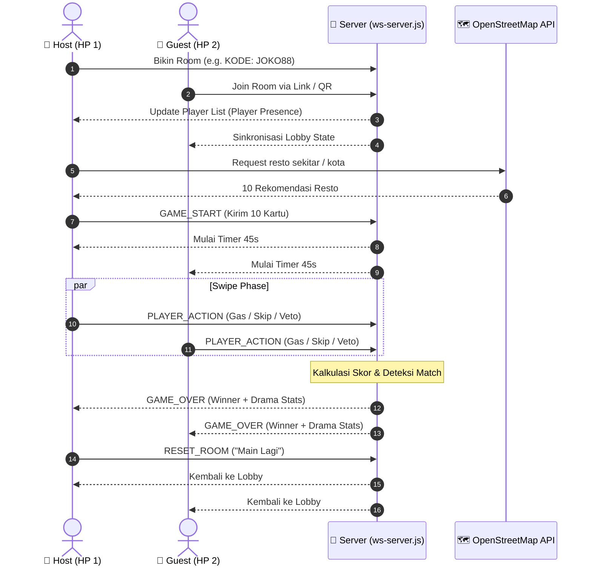

<div align="center">

# 🎰 TERSERAH!
### *Tongkrongan Decision Roulette*

> *"Mau makan di mana?" — "Terserah."*  
> **Solusi mutlak buat circle tongkrongan yang hobi bilang terserah!**

[](https://terserah-app-production.up.railway.app/)
[](https://svelte.dev/)
[](https://tailwindcss.com/)
[](https://github.com/websockets/ws)
[](https://www.openstreetmap.org/)

<br />

[🌐 Coba Aplikasi Langsung](https://terserah-app-production.up.railway.app/) · [🐛 Lapor Bug](https://github.com/vanoathalla/terserah-app/issues) · [⭐ Beri Star](https://github.com/vanoathalla/terserah-app)

</div>

---

## 💡 Tentang Aplikasi

**TERSERAH!** adalah web app multiplayer *real-time* yang didesain khusus buat memecahkan perdebatan klasik pas nongkrong: **"Mau makan di mana?"**. 

Setiap pemain masuk ke room yang sama lewat HP masing-masing, lalu swipe kanan (**⚡ GAS!**) atau swipe kiri (**🚫 SKIP**) kartu restoran ala Tinder. Dalam 45 detik, algoritma akan mencari *Match* mutlak atau mengalkulasi pemenang berdasarkan skor voting, lalu mencetak hasilnya ke dalam **Struk Kasir Thermal Retro** lengkap dengan drama statistik dan rute navigasi Google Maps!

> ⚡ **Zero Database. Zero Third-Party Cloud. 100% In-Memory WebSocket.** Semua room bersifat *ephemeral*, cepat, dan tanpa jejak data privasi.

---

## ✨ Fitur Unggulan

| Fitur | Deskripsi |
|---|---|
| 🚪 **Instant Room & QR Code** | Host bikin room 6-huruf dalam 1 detik. Teman tinggal scan QR Code atau klik link invite untuk langsung join tanpa perlu install aplikasi. |
| 🃏 **Tinder-Style Swipe Physics** | Swipe kartu dengan animasi spring physics berbasis pointer/touch (`svelte/motion`). Ada tombol alternatif untuk yang mager swipe. |
| 🚫 **1x Veto Card Privilege** | Punya trauma sama lele atau lagi bokek? Setiap orang punya 1 hak VETO untuk langsung mencoret 1 tempat dari daftar pilihan selamanya. |
| 🗺️ **OpenStreetMap & GPS Mode** | Mengambil data restoran & kafe riil secara otomatis di sekitar lokasi GPS kamu (via Nominatim & Overpass API) atau pilih preset kota (Jakarta, Bandung, Jogja, Surabaya, Bali). |
| 📍 **One-Click Google Maps** | Setelah pemenang ditentukan, langsung ada tombol buka rute ke Google Maps / OSM. Ga perlu ngetik ulang alamat manual. |
| 🧾 **Struk Kasir Estetik (HD PNG)** | Hasil akhir diformat rapi ala struk belanjaan mini-market jadul. Bisa langsung di-save ke galeri HP dalam format PNG 2x resolusi untuk story Instagram. |
| 🎭 **Drama Statistik** | Deteksi otomatis siapa temanmu yang: <br>• 😤 **Si Paling Rewel**: Paling sering nge-skip pilihan orang.<br>• 🫡 **Si Paling Pasrah**: Semua tempat di-GAS tanpa komplain.<br>• ⚡ **Swiper Terkenceng**: Yang paling cepet selesai vote.<br>• 🚫 **Pelaku Veto**: Siapa yang tega mencoret pilihan bersama. |
| 🔄 **Multiplayer Room Sync** | Host klik *Main Lagi*, semua layar pemain di HP masing-masing otomatis tersinkronisasi kembali ke Lobby untuk ronde berikutnya. |

---

## 🕹️ Cara Bermain

```
1️⃣ Host bikin Room baru di HP / Laptop
2️⃣ Share Kode Room (atau suruh temen scan QR Code di layar)
3️⃣ Tunggu semua temen kumpul di Lobby
4️⃣ Pilih mode: "Mock Demo" (12 Tempat Hits) atau "Open Maps" (Resto Sekitar)
5️⃣ Klik "MULAI!" → Semua pemain swipe kartu bersamaan (45 Detik)
6️⃣ Jika ada tempat yang di-GAS oleh SEMUA ORANG → ✨ IT'S A MATCH! ✨
7️⃣ Simpan struk kasirnya & gas berangkat makan!
```

---

## 📐 Skema Alur Real-time (WebSocket)



---

## 🧮 Rumus Kalkulasi Pemenang

Setiap kartu tempat makan dihitung berdasarkan formula berikut:

$$\text{Total Score} = (\text{Total Gas} \times 2) - \text{Total Skip}$$

> ⚠️ **Aturan Khusus Veto:** Jika suatu tempat terkena minimal **1x VETO**, skornya otomatis jatuh menjadi **`-999`** dan didiskualifikasi dari daftar kandidat pemenang.

---

## 🛠️ Tech Stack & Arsitektur

```
terserah-app/
├── src/
│   ├── lib/
│   │   ├── realtimeRoom.svelte.ts   # Client WS state manager (Svelte 5 Runes)
│   │   ├── mockPlaces.ts            # Curated places + OSM Nominatim & Overpass engine
│   │   ├── components/
│   │   │   ├── SwipeCard.svelte     # Interactive Tinder card with spring physics
│   │   │   ├── ReceiptResult.svelte # Thermal receipt view & html-to-image export
│   │   │   ├── PlayerAvatars.svelte # Real-time player avatars & animated presence
│   │   │   └── QRCode.svelte        # QR Code generator for quick onboarding
│   │   └── server/
│   │       ├── roomServer.ts        # In-memory room store & game server logic
│   │       └── wsPlugin.ts          # Vite dev WebSocket bridge
│   └── routes/
│       ├── +page.svelte             # Welcome screen, avatar selector & room entry
│       └── room/[code]/+page.svelte # Main Arena (Lobby → Swipe Arena → Receipt)
├── server.js                        # Production entry point (Node HTTP + WebSocket Server)
├── scripts/build-ws.js              # Bundles roomServer.ts -> build/ws-server.js (esbuild)
└── nixpacks.toml                    # Railway deployment blueprint
```

| Bagian | Teknologi | Keterangan |
|---|---|---|
| **Frontend Framework** | [SvelteKit](https://kit.svelte.dev/) + [Svelte 5](https://svelte.dev/) | Memanfaatkan fitur terbaru **Runes** (`$state`, `$derived`, `$effect`) untuk reaktivitas super kencang tanpa overhead. |
| **Styling** | [Tailwind CSS](https://tailwindcss.com/) | Desain tema **Neo-Brutalism** (border hitam tebal, high-contrast palette, hard shadow). |
| **Realtime Engine** | [Native WebSocket (ws)](https://github.com/websockets/ws) | Arsitektur *Zero Database*. Room disimpan di RAM server (ephemeral). Begitu selesai, room otomatis dibersihkan. |
| **Animasi** | `svelte/motion` | Spring physics interaktif untuk gesture drag-and-swipe. |
| **Geolokasi** | [OpenStreetMap](https://www.openstreetmap.org/) | Menggunakan **Nominatim Search API** dengan fallback ke **Overpass API Mirrors**. |
| **Navigasi** | Universal Google Maps & OSM Links | Membuka koordinat latitude/longitude langsung di Google Maps native app. |
| **Image Generation** | `html-to-image` | Render DOM struk kasir ke format file gambar PNG 2x retina display. |
| **Deployment** | [Railway](https://railway.app/) + [Nixpacks](https://nixpacks.com/) | Deployment terotomatisasi dengan Node.js 22 runtime. |

---

## 🚀 Menjalankan Secara Lokal

### Prasyarat
- [Node.js](https://nodejs.org/) v18 atau v20+
- npm / pnpm / yarn

```bash
# 1. Clone repository
git clone https://github.com/vanoathalla/terserah-app.git
cd terserah-app

# 2. Install dependencies
npm install

# 3. Jalankan development server
npm run dev
```

Buka `http://localhost:5173` di browser kamu.

### Mabar di Satu Jaringan WiFi (LAN):
Untuk mencoba multiplayer bersama teman di satu jaringan WiFi:
```bash
npm run dev -- --host
```
Bagikan alamat **Network URL** yang tampil di terminal (misal `http://192.168.1.15:5173`) ke HP teman-temanmu.

---

## 🏗️ Build & Production

```bash
# Compile SvelteKit frontend + bundle backend WebSocket server
npm run build

# Menjalankan server produksi
node server.js
```

---

## 📄 Lisensi

Didistribusikan di bawah lisensi MIT. Silakan gunakan, modifikasi, dan deploy untuk keperluan pribadi maupun tongkronganmu!

<div align="center">
  <sub>Dibuat dengan ❤️ & frustrasi karena kelamaan mikir mau makan apa.</sub>
</div>
